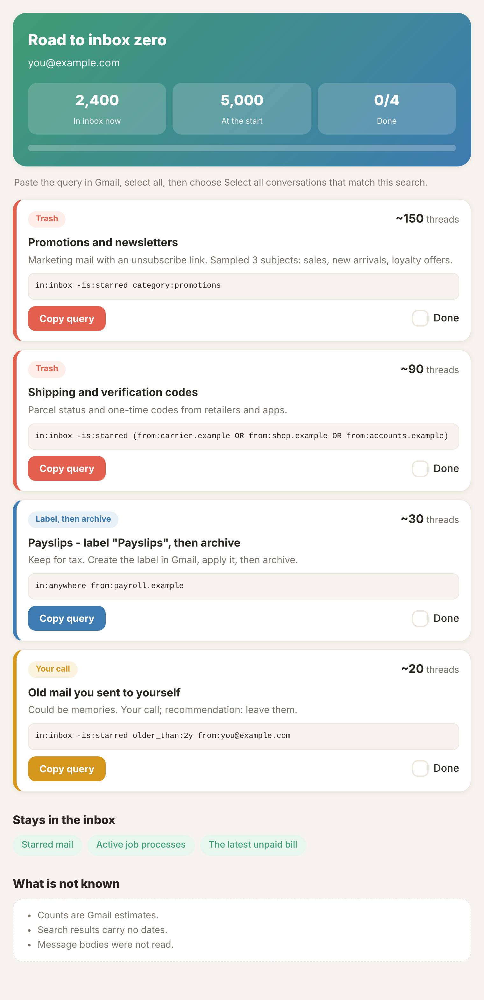

# inbox-zero-gates

A Claude skill that takes a cluttered Gmail inbox toward zero **without blind deletion**.

Claude reads, groups and judges. **You** do the deleting, by pasting a Gmail query. Every conclusion passes
through a set of safety **gates** that were learned the hard way, in a real session that took an inbox from
about 5,400 threads to about 270.



*The report the skill produces (fictional data). Open [`examples/example-report.html`](examples/example-report.html) in a browser to try the Copy button and the Done checkboxes.*

## Why gates
Inbox tools usually fail in one of three ways: they delete something that mattered, they describe a sender
wrongly because of its name, or they report numbers they cannot know. The gates are the fixes.

| Gate | Rule |
|------|------|
| G1 Read-only | No write action without a specific request |
| G2 Protected | Starred, replied-to, official, medical, insurance, tax, pending bills, active job processes are never in a delete query without an explicit OK |
| G3 Sample before judging | Three real subjects per group before naming it |
| G4 Measure, do not assume | Count a heuristic before using it |
| G5 Estimate honesty | Counts are estimates, no dates, bodies unread |
| G6 Verify the query | Run it, scan for protected senders, parenthesize every OR |
| G7 Right action type | Trash for junk; label then archive for documents |
| G8 Keepsakes | Mail sent to yourself and very old personal mail: ask once |
| G9 Active process | Recent pipeline, unpaid bills, open claims stay |
| G10 Scam | Lookalike billing mail is phishing: flag, never reply |
| G11 Tool limits | Never loop per-thread trash calls |
| G12 One decision per group | Buttons, recommended option first |
| G13 Verify after | Re-run the query, expect empty, report exact totals |
| G14 Overlap | State the order; totals are approximate |
| G15 Privacy | The report is private, never publish it |
| G16 Know when to stop | Stop when the rest belongs to the user |

Details and the incident behind each gate: [`references/gates.md`](references/gates.md).

## What you get
1. A grouped analysis of your inbox, by sender, with sampled subjects.
2. For each group an action: **Trash**, **Label then Archive**, **Keep**, or **Your call**.
3. A paste-ready Gmail query per group, verified before you see it.
4. A private HTML report (`scripts/build_report.py`) with a Copy button and a done-checkbox per group.
   Works on a phone, light and dark, English (LTR) or Hebrew (RTL).

## First run: it learns what matters to you
Before it scans anything, the skill runs a short setup interview:
1. It infers candidates from your own mailbox: people you reply to, senders of starred mail, official-looking senders, and the labels you already use.
2. It shows them and asks what must never be touched, which labels to reuse, whether old personal mail is sentimental, and whether you are waiting on a process (job search, claim, refund).
3. It offers to save your answers as a small rules file, so the next run only looks at new mail.

Inference proposes, you decide. Nothing inferred is treated as protected or as deletable until you confirm it.

## Requirements
- Claude with a Gmail connector that offers `search_threads`, `get_thread` and `list_labels`.
- Python 3 for the report builder (standard library only).

## Install
Copy the folder to your Claude skills directory (or upload it as a skill), then say:

> Run inbox-zero-gates on my inbox. Start read-only.

## Build a report by hand
```bash
python3 scripts/build_report.py examples/example-groups.json report.html
```
Set `"lang": "he"` for a right-to-left Hebrew layout.

## Privacy
The report contains your private subjects and senders. Keep it private. This repository contains no personal
data, only the method, the gates and a fictional example.

## Safety
Everything the skill proposes ends in Trash (recoverable for 30 days) or a label. Nothing is deleted permanently.

## License
MIT
